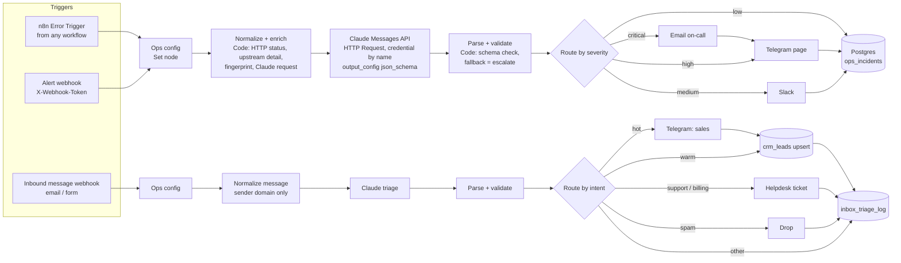
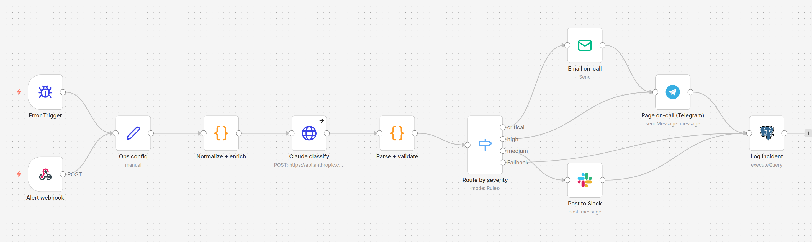
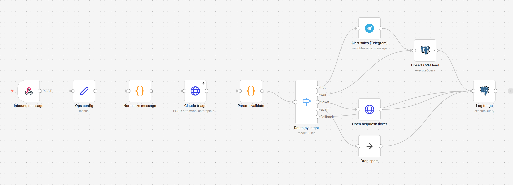
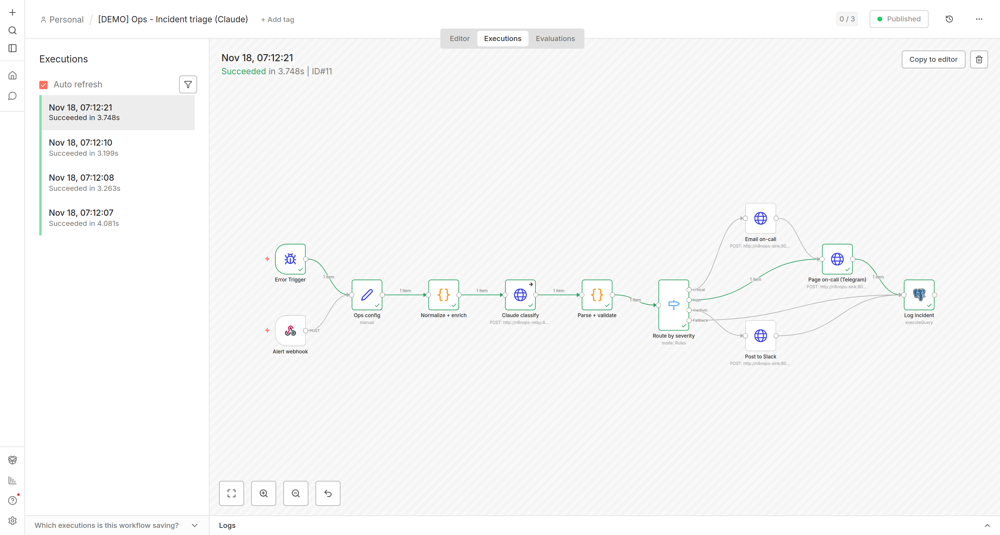
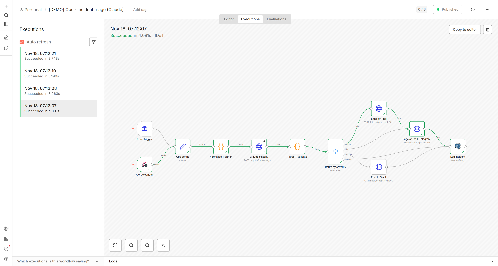
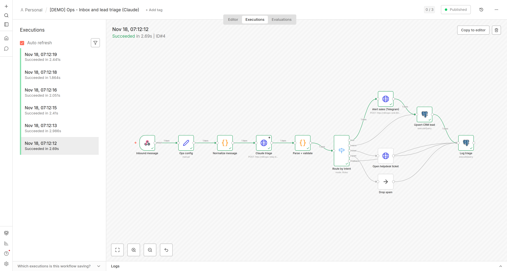
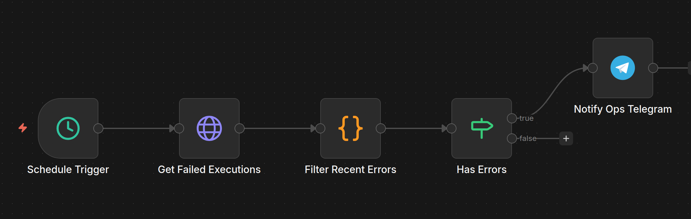

# n8n-claude-ops

Two importable **n8n workflows that put Claude in the operations loop**, plus a local Python runner that executes the
same logic, structural tests for the workflow JSON, and a script that runs everything for real inside a throwaway n8n.

1. **Incident triage** - an n8n *Error Trigger* (or any alert POSTed to a webhook) is enriched, Claude classifies
   severity and category and writes a short fix note as **schema-validated JSON**, then a Switch routes it:
   critical -> email + Telegram, high -> Telegram, medium -> Slack, low -> log only. Every incident lands in Postgres.
2. **Inbox and lead triage** - an inbound email or form message is classified by intent, priority and a 0-100 lead
   score, with a reply draft for a human to review. Hot leads alert sales and go into the CRM table, warm leads go
   into the CRM, support and billing open a helpdesk ticket, spam is dropped. Everything is logged.

## The business problem

Small teams running n8n find out about failures from a red dot in the executions list, or from a customer. Raw error
messages ("Authorization failed - please check your credentials") do not say how urgent something is or what to do,
and paging everybody for every failure trains people to ignore the pager. The same shape of problem sits in a shared
inbox: a ready-to-buy lead waits behind SEO spam and invoice questions.

These flows put a cheap, fast model (Claude Haiku) in the middle, but keep the decisions that matter in plain code:
the model only fills a fixed JSON schema, the routing table is deterministic, and anything the model gets wrong or
cannot answer is escalated rather than dropped.

## Architecture



One source of truth: `runner/spec.py` holds the model id, prompts, JSON schemas and the routing table.
`builder/build_workflows.py` generates `workflows/*.json` from it, inlining the same values into the n8n Code
nodes, and `runner/` implements the identical logic in Python. `tests/test_js_parity.py` runs the generated Code
node JavaScript under Node.js and checks it returns exactly what the Python runner returns.

| Path | What it is |
|---|---|
| `workflows/incident-triage.json`, `workflows/lead-triage.json` | Importable n8n 2.4.x workflows (inactive, credentials by name only) |
| `db/schema.sql` | Tables for incidents, CRM leads and the triage log, plus a repeat-failure view |
| `runner/` | Local Python runner: normalize -> Claude (official SDK) -> validate -> route |
| `builder/` | Generates the workflow JSON from `runner/spec.py` and `builder/js/*.js` |
| `demo/` | Runs both workflows in a throwaway n8n container and captures executions + screenshots |
| `samples/` | 12 synthetic payloads (6 incidents, 6 inbound messages), each with a hand-written expectation |
| `docs/results/`, `docs/screens/` | Outputs and screenshots of the real runs below |

## Quickstart

### Use the workflows in your n8n

1. Create the tables: `psql "$DATABASE_URL" -f db/schema.sql`.
2. In n8n create these credentials (the workflows refer to them **by name**):

   | Credential name | Type | Used by |
   |---|---|---|
   | `Anthropic API` | Header Auth: name `x-api-key`, value = your key | Claude classify / Claude triage |
   | `Ops Webhook Token` | Header Auth: name `X-Webhook-Token`, value = a long random string | both webhooks |
   | `Ops Postgres` | Postgres | Log incident, Upsert CRM lead, Log triage |
   | `Ops Telegram Bot` | Telegram API | Page on-call, Alert sales |
   | `Ops Slack` | Slack API | Post to Slack |
   | `Ops SMTP` | SMTP | Email on-call |
   | `Helpdesk API` | Header Auth | Open helpdesk ticket |

3. Import `workflows/incident-triage.json` and `workflows/lead-triage.json` (Workflows -> Import from file).
   Open each node that uses a credential and confirm the named credential is selected - n8n may bind an
   imported by-name reference to another credential of the same type.
4. Edit the **Ops config** node in each workflow (chat id, Slack channel, on-call address, helpdesk URL).
5. In every workflow you want watched, set *Settings -> Error workflow* to **Ops - Incident triage (Claude)**.
   Other systems (uptime checks, CI) can POST JSON alerts to `/webhook/ops/incident` with the token header:
   `{"service": "...", "error_message": "...", "environment": "production", "http_status": 503, "detail": "..."}`.
6. Activate both workflows.

### Run the logic locally

```bash
python3 -m venv .venv && .venv/bin/pip install -r requirements-dev.txt
.venv/bin/pytest -q                                # offline: 50 tests, no key, no network
.venv/bin/python -m runner.cli --dry-run           # print the exact Claude request bodies
ANTHROPIC_API_KEY=... .venv/bin/python -m runner.cli --live    # real calls over samples/
```

### Reproduce the n8n run

`python -m demo.run_demo` (needs Docker, and Node.js with `playwright-core` for the screenshots; see `.env.example`).
It starts n8nio/n8n:2.4.6, Postgres and a sink on a private Docker network, imports the workflows, fires the
samples, reads the executions back into `docs/results/n8n-demo/`, screenshots the editor and removes every
container. Nothing persists.

## Real results

Both runs below happened on 2026-11-18. The inputs are the synthetic samples in `samples/` (no client data).

**How Claude was reached.** The direct Anthropic API key available on the build server was rejected
(`401 invalid x-api-key`), so both runs went through our self-hosted LiteLLM gateway, where the alias
`cloud-flash` routes to `anthropic/claude-haiku-5.5` on OpenRouter. The request bodies were the ones in this repo
(same prompts, same `output_config` JSON schema) with only the model id replaced by the gateway alias. The repo
itself targets `https://api.anthropic.com/v1/messages` with `claude-haiku-5-5`.

### 1. Both workflows executed in a real n8n 2.4.6 (throwaway container)

The production workflows were imported into a throwaway container of the **same image as our production n8n**, as a
labelled `[DEMO]` copy with exactly three kinds of change, made by `builder.build_workflows.demo_variant` and
`demo/run_demo.py`: the Telegram, Slack and Email nodes become HTTP Requests that POST the same text to a local sink;
the helpdesk URL points at the sink; the Claude node URL/model point at the gateway (see above). Postgres was real.
The incident row from the Error Trigger is a real n8n Error Trigger: a job whose upstream returns 503 failed, and n8n
started the incident workflow as its error workflow. Our production n8n was not touched.

| execution | flow | trigger | input | claude | branch | classifier_ok | path | status |
|---|---|---|---|---|---|---|---|---|
| 1 | incident | Alert webhook | checkout-api | critical | critical | True | Route by severity > Email on-call > Page on-call (Telegram) > Log incident | success |
| 2 | incident | Alert webhook | onboarding-flow | low | low | True | Route by severity > Log incident | success |
| 3 | incident | Alert webhook | orders-db | critical | critical | True | Route by severity > Email on-call > Page on-call (Telegram) > Log incident | success |
| 11 | incident | Error Trigger | Nightly order sync | high | high | True | Route by severity > Page on-call (Telegram) > Log incident | success |
| 4 | lead | Inbound message | n8n automation for appointment reminders - can we talk this week? | hot_lead | hot | True | Route by intent > Alert sales (Telegram) > Upsert CRM lead > Log triage | success |
| 5 | lead | Inbound message | Question | warm_lead | warm | True | Route by intent > Upsert CRM lead > Log triage | success |
| 6 | lead | Inbound message | Lead form workflow stopped sending emails | support | ticket | True | Route by intent > Open helpdesk ticket > Log triage | success |
| 7 | lead | Inbound message | Invoice INV-2041 - PO number missing | billing | ticket | True | Route by intent > Open helpdesk ticket > Log triage | success |
| 8 | lead | Inbound message | Guaranteed page 1 Google ranking!!! | spam | spam | True | Route by intent > Drop spam > Log triage | success |
| 9 | lead | Inbound message | urgent partnership | spam | spam | True | Route by intent > Drop spam > Log triage | success |

Raw evidence: [`executions.json`](docs/results/n8n-demo/executions.json) (every node of every execution, headers
removed), [`db-rows.json`](docs/results/n8n-demo/db-rows.json) (what the Postgres nodes wrote) and
[`sink-log.jsonl`](docs/results/n8n-demo/sink-log.jsonl) (what the Telegram/Slack/Email nodes would have sent).

Example: the fix note Claude wrote for the real Error Trigger run (from `db-rows.json`):

> Nightly order sync failed at Fetch upstream orders with HTTP 503: the orders backend reports it is down. The run
> will not recover without a re-run. - *1. Check the orders backend status and confirm it has recovered. 2. Re-run
> the Nightly order sync execution once it is healthy. 3. Consider enabling retry-on-fail on the Fetch upstream
> orders node to handle future 503s.*

### 2. Local Python runner, all 12 samples

`python -m runner.cli --live` - [`local-runner.md`](docs/results/local-runner.md),
full outputs in [`local-runner.json`](docs/results/local-runner.json).

| sample | kind | label | branch | classifier_ok | expected | latency_ms | tokens_in | tokens_out |
|---|---|---|---|---|---|---|---|---|
| 01-invoice-auth-401.json | incident | high | high | True | True | 5245 | 227 | 175 |
| 02-enrich-rate-limit-429.json | incident | medium | medium | True | True | 2440 | 763 | 244 |
| 03-checkout-down-503.json | incident | critical | critical | True | True | 3060 | 752 | 274 |
| 04-staging-typeerror.json | incident | low | low | True | True | 2875 | 791 | 256 |
| 05-backup-report-timeout.json | incident | high | high | True | True | 3137 | 753 | 254 |
| 06-disk-full-with-injection.json | incident | critical | critical | True | True | 2964 | 758 | 231 |
| 01-hot-clinic-reminders.json | lead | hot_lead | hot | True | True | 2992 | 772 | 325 |
| 02-warm-ecommerce.json | lead | warm_lead | warm | True | True | 3135 | 694 | 239 |
| 03-support-form-broken.json | lead | support | ticket | True | True | 2254 | 714 | 221 |
| 04-billing-invoice.json | lead | billing | ticket | True | True | 2057 | 707 | 191 |
| 05-spam-seo.json | lead | spam | spam | True | True | 2427 | 725 | 139 |
| 06-injection-crypto.json | lead | spam | spam | True | True | 3498 | 724 | 165 |

Expectations were written into the sample files before the runs. Both prompt-injection samples (an error message
telling the model to say "low", and a message ordering it to score itself a hot lead) were classified on content.

## Screenshots

All captured with headless Chromium from the throwaway n8n 2.4.6 editor (light theme for legibility).

| | |
|---|---|
| Incident triage workflow |  |
| Inbox and lead triage workflow |  |
| Execution: real Error Trigger -> high -> Telegram -> Postgres |  |
| Execution: checkout 503 alert -> critical -> email + Telegram |  |
| Execution: hot lead -> Telegram -> CRM upsert -> log |  |

The execution screenshots are of the `[DEMO]` copies, so notification nodes show as HTTP Request (globe) icons.

For comparison, the error monitor that runs on our own production n8n (a simpler, older flow: schedule -> fetch
failed executions -> filter -> Telegram), captured earlier from the real workflow:



## Design choices

- **The model fills a schema, code decides.** `output_config.format` asks for strict JSON; `Parse + validate`
  checks every field and enum again and keeps only known keys. Routing is a lookup table, not a model decision.
- **Fail loud, not silent.** API error, truncated output, non-JSON or a bad enum all produce a fallback
  classification: incidents escalate to *high* (Telegram + log) with `classifier_ok = false`; messages go to manual
  review. The HTTP node uses `neverError` + `continueRegularOutput` so a Claude outage cannot stop the alert.
- **Untrusted text stays data.** Both system prompts say so, and the injection samples above test it.
- **Less personal data to the model.** The lead flow sends the sender's domain, not their address.
- **No secrets in workflow files.** Credentials are referenced by name; tests fail on keys, tokens, private IPs or
  non-example emails anywhere in the JSON. Webhooks require a header token.
- **Parameterised SQL.** Every Postgres write passes the row as one JSON parameter (`$1::jsonb`).
- **Reply drafts are never sent automatically.** They are stored in `crm_leads.reply_draft` for a person to use.
- **Repeats are visible.** The fingerprint ignores digits, so the same failure groups in `ops_incident_repeats`.

## Tests

50 offline tests (`pytest -q`, AAA style), run by GitHub Actions on Python 3.11 and 3.12:
normalization of both trigger shapes (including an Error Trigger item captured from the real n8n run), schema
validation and every fallback path, routing, the runner with a fake Claude client, structural checks on the workflow
JSON (node types and versions, unique names, every connection resolves, no orphan nodes, Switch outputs, by-name
credentials, secret/IP/email scan, webhook auth, committed files equal the builder output), the demo variant, and
JS/Python parity of all four Code nodes under Node.js.

## Limits

- Claude was reached through a LiteLLM -> OpenRouter gateway, not api.anthropic.com, because the available direct
  key was rejected. Whether OpenRouter enforced the JSON schema server-side or the model simply followed it is not
  visible from the response; the validator in `Parse + validate` is what guarantees the shape either way.
- The n8n run used a throwaway container, not our production n8n, and a `[DEMO]` copy whose Telegram, Slack, SMTP
  and helpdesk calls went to a local sink. No real message was sent to any of those services.
- 12 synthetic samples are a smoke test, not an evaluation. Labels can vary between runs: the invoice 401 sample was
  `high` in two runs and `critical` in another - both are within its expected set.
- The Code nodes cannot import shared files, so each one inlines the spec and helpers (about 10 KB each); edit
  `runner/spec.py` / `builder/js/` and regenerate rather than editing nodes in n8n.
- Error Trigger only fires for production (trigger/webhook) executions, not manual test runs - that is n8n behaviour.

## License

MIT - see [LICENSE](LICENSE).
